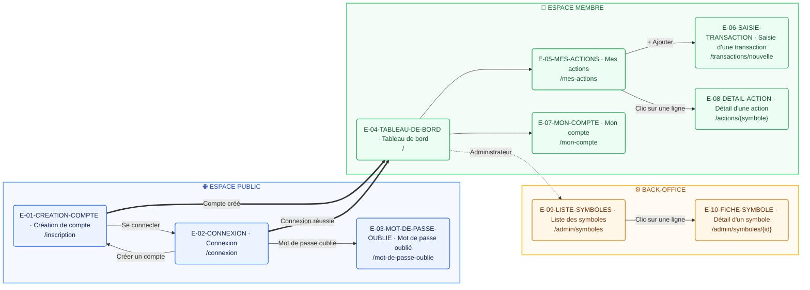

# Gabarits des fichiers produits par `/presta-spec`

Règles communes :

- **Vouvoiement** dans tout ce qui s'adresse au lecteur.
- **Markdown pur.** Les écrans sont des blocs de code, la navigation est un bloc
  `mermaid`. Pas d'images, pas de captures.
- **Aucune supposition écrite.** Ce qui n'a pas été validé n'apparaît pas, ou apparaît
  en `À PRÉCISER`.
- **Identifiants** : préfixe + numéro + slug, en majuscules, sans accents —
  `E-01-CREATION-COMPTE`, `M-06-TRANSACTION`, `D-02-FOURNISSEUR-COTATION`. Le slug fait
  1 à 3 mots significatifs, sans article. **Il n'existe pas de forme courte** : un
  identifiant s'écrit toujours en entier, partout, y compris dans la conversation. Le
  numéro ne change jamais et ne se réutilise jamais. Dans un nom de fichier, le même
  identifiant s'écrit en minuscules : `apercus/e-05-mes-actions.html`.
- Sur projet existant, ces fichiers se **modifient**. Jamais de copie `v1/`, `v2/`.
- **Tout fichier généré vit dans `generated/`**, à côté de sa source.
- **Horodatage** : le champ `maj:` porte la date **et l'heure à la seconde**, en
  ISO-8601 — `2026-08-20T14:32:07`, obtenu avec `date +%FT%T`. C'est ce qui permet à un
  fichier dérivé de savoir qu'il est périmé : deux écritures du même jour se distinguent.
  Les noms de fichiers, eux, ne portent que la date.

---

## `presta/specs/spec-ecrans.md`

Écrit **au fil de l'eau** : chaque écran validé est ajouté immédiatement. La navigation
est ajoutée à la clôture.

````markdown
---
version: 1.0
maj: AAAA-MM-JJTHH:MM:SS
source: rdv-NN — {label}
---

# Spécification des écrans — {Nom du projet}

## Liste des écrans

| ID | Écran | URL | Espace | Fonctionnalités | État |
|---|---|---|---|---|---|
| E-01-CREATION-COMPTE | Création de compte | /inscription | Public | F-03-GESTION-COMPTE | validé |
| E-02-CONNEXION | Connexion | /connexion | Public | F-03-GESTION-COMPTE | validé |
| E-05-MES-ACTIONS | Mes actions | /mes-actions | Membre | F-01-SUIVI-PORTEFEUILLE, F-04-EXPORT-CSV | validé |

La colonne **Fonctionnalités** cite les `F-xx` de `spec-produit.md` que l'écran porte.
C'est ce qui rend le contrôle de complétude mécanique.

La colonne **État** vaut `validé`, `en cours`, `à faire` ou `supprimé`.

---

## E-01-CREATION-COMPTE — Création de compte

**URL** : `/inscription`
**Espace** : Public
**Fonctionnalités** : F-03-GESTION-COMPTE

```
    ┌──────────────────────────────────────────────────┐
    │  ...                                             │ <- ...
    └──────────────────────────────────────────────────┘
```

### Autres états de l'écran
- Quand l'utilisateur clique sur « … » et que …, alors …

### Erreurs possibles
- {Le message, rédigé tel qu'il s'affichera.}

### Actions utilisateur
- Remplir le formulaire et cliquer sur « … »
- Naviguer vers « … » (/url)

### Éléments visuels
- GRAPHIQUE « … » — données, période, interaction, ce qu'il affiche sans données.
- IMAGE « … » — ce qu'elle doit faire comprendre. Produite à l'étape maquettes.

### Indications de disposition
{Uniquement ce que l'utilisateur a dit spontanément — « ça, c'est un onglet », « ça,
ce sera une pop-up ». Matière pour /presta-maquettes. Rubrique absente s'il n'a rien dit.}

### À préciser
- {Le point laissé de côté, en une ligne. Rubrique absente s'il n'y en a pas.}

---

## E-02-CONNEXION — Connexion

...

---

## Navigation


````

### Le gabarit Mermaid, en règles

- `flowchart LR`, un `subgraph` par espace, chacun en `direction TB`.
- Titre de `subgraph` en majuscules, précédé d'un emoji : 🌐 public, 🔐 membre,
  ⚙️ back-office.
- Nœuds ronds `("E-NN · Titre<br/>/url")` — l'ID, le titre, l'URL.
- Étiquettes de liens = **le libellé exact du bouton ou du lien**, cohérent avec la
  rubrique « Actions utilisateur » de l'écran.
- `==>` pour les transitions principales du parcours, `-->` pour le reste, `-.->` pour
  une navigation conditionnée par un rôle, avec le rôle en étiquette.
- Une `classDef` par espace, plus un `style` sur le `subgraph`.

Mermaid se rend nativement dans VS Code (1.121 et suivantes) et sur GitHub. Aucun compte,
aucun service.

---

## `presta/specs/generated/acces-par-role.md`

**Fichier généré.** Réécrit en entier à chaque passage de `/presta-spec`. Déduit
uniquement de `spec-ecrans.md` — aucune information nouvelle.

```markdown
---
genere_par: /presta-spec
source: spec-ecrans.md — v1.0, AAAA-MM-JJTHH:MM:SS   # recopié tel quel depuis son maj:
maj: AAAA-MM-JJTHH:MM:SS
---

# Accès par rôle — {Nom du projet}

> Fichier généré. Ne le modifiez pas à la main : il est déduit de `spec-ecrans.md`
> et réécrit en entier à chaque passage de `/presta-spec`. Pour changer un accès,
> changez l'écran dans `spec-ecrans.md`.

## Accès par écran

| Écran | URL | Visiteur | Membre | Administrateur |
|---|---|---|---|---|
| E-01-CREATION-COMPTE | /inscription | ✓ | redirigé vers / | redirigé vers / |
| E-02-CONNEXION | /connexion | ✓ | redirigé vers / | redirigé vers / |
| E-04-TABLEAU-DE-BORD | / | ✗ | ✓ ses données | ✓ ses données |
| E-05-MES-ACTIONS | /mes-actions | ✗ | ✓ ses données | ✓ ses données + « Rafraîchir » |
| E-08-DETAIL-ACTION | /actions/{symbole} | ✗ | ✓ ses données | ✓ ses données |
| E-09-LISTE-SYMBOLES | /admin/symboles | ✗ | ✗ | ✓ |

## Actions à accès restreint

| Action | Écran | Rôle requis | Ce qui doit être vérifié côté serveur |
|---|---|---|---|
| « Rafraîchir » les cours | E-05-MES-ACTIONS | Administrateur | Le rôle de l'appelant |
| Ouvrir /actions/{symbole} | E-08-DETAIL-ACTION | Membre | Que la ligne appartient bien à l'appelant |
| Désactiver un symbole | E-10-FICHE-SYMBOLE | Administrateur | Le rôle de l'appelant |
| Désactiver un utilisateur | E-11-LISTE-UTILISATEURS | Administrateur | Le rôle de l'appelant, et qu'il ne se désactive pas lui-même |
```

Le second tableau est celui que `/presta-audit` consomme pour son contrôle
d'autorisation. Le champ `source` du frontmatter lui permet de détecter une synthèse
périmée et de refuser de conclure dessus.

---

## La règle de propagation de `spec-ecrans.md`

**C'est ici qu'elle est définie.** Les autres skills y renvoient.

Deux fichiers dérivent de `spec-ecrans.md`, et aucun ne se recalcule tout seul :

| Fichier dérivé | Champ de provenance | Régénéré par |
|---|---|---|
| `presta/specs/generated/acces-par-role.md` | `source:` | `/presta-spec`, `/presta-valide-specs` |
| `presta/specs/spec-ux.md` + les aperçus | `base_specs:` | **`/presta-maquettes` uniquement** |

Quatre écrivains ont le droit d'écrire dans `spec-ecrans.md` : `/presta-spec`, son
propriétaire, plus `/presta-modeles`, `/presta-valide-specs` et la voie rapide de
`/presta-rdv` — ces trois-là pour un **ajustement local** seulement (un message d'erreur,
un état manquant, un libellé, une destination). Une reprise structurelle — un écran à
découper, à créer, un parcours à refaire — remonte à `/presta-spec`.

Chacun des quatre doit trois choses, dans cet ordre :

1. **Mettre `maj:` à l'horodatage du moment** (`date +%FT%T`). C'est ce qui rend la
   péremption détectable — sans ça les deux contrôles ci-dessous ne se déclenchent jamais.
   `version:` **ne bouge pas** : c'est la version du produit, elle appartient au
   rendez-vous.
2. **Régénérer `presta/specs/generated/acces-par-role.md`**, et y recopier le nouveau
   `maj:` **tel quel** dans son champ `source:`. Le fichier généré ne lit jamais l'horloge
   pour ce champ-là : s'il stampait sa propre génération, il serait toujours postérieur
   d'une seconde et jamais détecté comme périmé.
3. **Signaler les aperçus périmés à la sortie**, en une ligne, et renvoyer vers
   `/presta-maquettes`. On ne régénère pas un aperçu ailleurs que là : elle seule dispose
   du gabarit HTML, du `design-system.css` et des conventions `L-xx`.

```
2 corrections touchent E-05-MES-ACTIONS et E-09-LISTE-SYMBOLES. Leurs aperçus et
leur ligne dans spec-ux.md sont périmés — à régénérer avec /presta-maquettes.
```

**Toute ligne « ✓ ses données » produit une ligne dans le second tableau.** C'est le trou
classique du code généré : l'accès à la ressource d'autrui en changeant l'identifiant
dans l'URL.

---

## Mises à jour des autres fichiers

### `presta/specs/spec-produit.md`

- Une fonctionnalité `F-xx` non couverte que l'utilisateur décide de reporter passe en
  « Évolutions envisagées », avec la date et la raison.
- Un hors-scope découvert pendant la spec s'ajoute à « Hors périmètre ».

### `presta/specs/spec-technique.md`

Les décisions ouvertes pendant la spec, dans la section « décisions techniques »,
numérotées `D-xx` à la suite de celles du rendez-vous :

Le format est celui de `/presta-rdv` — on ne crée pas une seconde présentation :

```markdown
### D-03-FREQUENCE-COURS — Fréquence de rafraîchissement des cours
Statut : en attente
Enjeu : le coût des appels au fournisseur de cotation dépend de la fréquence ; E-04-TABLEAU-DE-BORD et
E-05-MES-ACTIONS ne peuvent pas être implémentés tant que ce n'est pas tranché.
Piste : une mise à jour journalière suffit peut-être — à chiffrer.
Ouvert le AAAA-MM-JJ par /presta-spec, écran E-05-MES-ACTIONS.
```

### `presta/elements-a-fournir.md`

Les points laissés de côté à la clôture, avec ce qu'ils bloquent. **Le format du fichier
est défini dans les gabarits de `/presta-rdv`** — une puce `- [ ]`, dans la section de
priorité qui convient. L'IA n'y coche jamais rien.

```markdown
- [ ] **Liste des filtres et des tris de E-05-MES-ACTIONS** — à définir avec vous.
  Bloque l'implémentation de E-05-MES-ACTIONS : la barre de filtres ne peut pas être
  développée tant que son contenu n'est pas arrêté.
```

### `presta/status.md`

- `etape: specs` dans l'en-tête.

### `presta/regles-projet.md`

- Dans les décisions figées, si elle n'y est pas déjà :

> Toute écriture dans `presta/specs/spec-ecrans.md` impose trois choses, dans cet ordre :
> son `maj:` passe à l'horodatage du moment (`date +%FT%T`, `version:` ne bouge pas) ;
> `presta/specs/generated/acces-par-role.md` est régénérée, avec ce `maj:` recopié tel quel
> dans son `source:` ; les aperçus et les lignes de `spec-ux.md` des écrans touchés sont
> signalés périmés, à régénérer avec `/presta-maquettes`.

C'est la règle de propagation ci-dessus, sous la forme que lisent les sous-agents.
